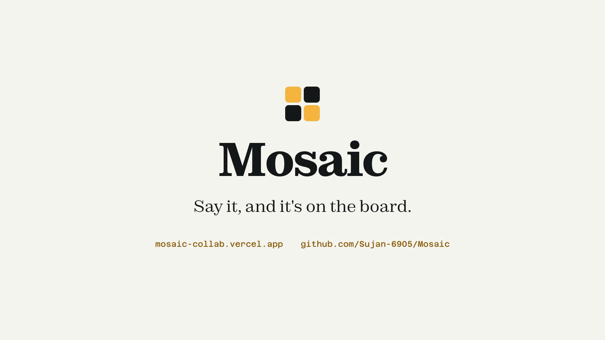
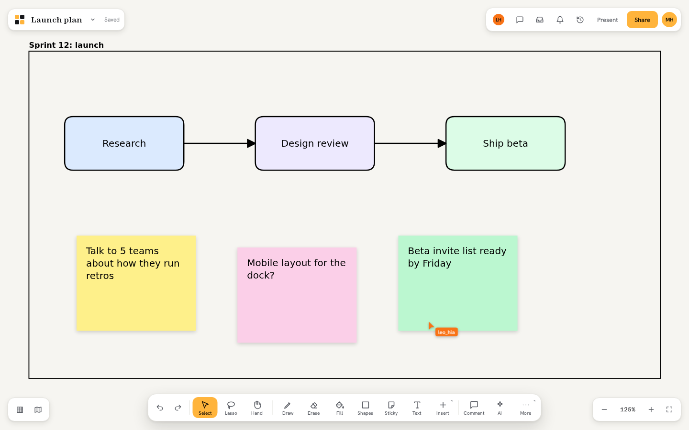
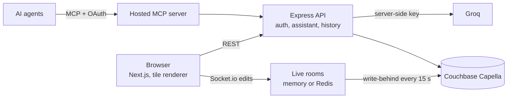

# Mosaic: a real-time collaborative whiteboard with an AI diagram assistant

[](https://github.com/Sujan-6905/Mosaic/actions/workflows/ci.yml)
    

Mosaic is a free online whiteboard on an infinite canvas where a whole team draws, diagrams and brainstorms at
once. An AI assistant turns a sentence into an editable diagram or edits what is already on the board, every
change is kept so a board can be replayed, branched and merged, and AI agents such as Claude can join a board
through MCP.

**Live:** [mosaic-collab.vercel.app](https://mosaic-collab.vercel.app/) ·
**How it works:** [/about](https://mosaic-collab.vercel.app/about) ·
**User guide:** [/docs](https://mosaic-collab.vercel.app/docs) ·
**Developer docs:** [docs/](docs/README.md)

[](docs/media/mosaic-trailer.mp4)

_The film is recorded from the running app. Music: "Simplicity" by Scott Buckley
([scottbuckley.com.au](https://www.scottbuckley.com.au)), licensed under [CC BY 4.0](https://creativecommons.org/licenses/by/4.0/)._



## Features

- **Live collaboration.** Cursors, presence, follow and present, threaded comments with mentions, and roles
  (owner, editor, commenter, viewer) enforced on the server for every change.
- **Infinite canvas.** Pencil, pen and highlighter with pressure, 18 shapes that hold text, sticky notes,
  frames, tables, images, live embeds and connectors that stay attached. Pans smoothly at 50,000 elements.
- **AI assistant.** Ask a question, describe a diagram or ask for a change in one box. Diagrams come back
  editable in 72 structures and 43 looks; edits are previewed on the board before anything changes; hand-drawn
  sketches become clean diagrams.
- **History.** Every change is logged: name versions, scrub a replay, branch a board, diff it and three-way
  merge it back.
- **Diagrams from anywhere.** Mermaid code, a public GitHub repository's architecture, or 18,000 icons and
  fourteen kits (BPMN, UML, cloud, UI and more) become ordinary board shapes.
- **For AI agents.** A hosted MCP server with OAuth lets Claude, Cursor or VS Code read, draw and edit boards as
  a visible collaborator, with every tool call undoable.
- **Share anywhere.** Export PNG, SVG, PDF or a lossless `.mosaic` file, embed a live read-only board on another
  site, and find any board by what is drawn on it.
- **Accessible and themed.** Six themes including high contrast, full keyboard control and a command palette.

## Architecture



- **Conflicts:** last-write-wins per element with server-stamped versions, and a Yjs CRDT for text, so two
  people typing in one note both keep their words.
- **Rendering:** cached bitmap tiles and a spatial index, so a repaint costs what is on screen, not what is on
  the board.
- **Assistant:** the model never places anything. It returns nodes and edges or operations on named objects,
  and deterministic code lays out, validates, lints and repairs before a person reviews the change.
- **Scale:** with Redis, any backend instance can serve any room, so a load balancer needs no sticky sessions.

More in [Architecture](docs/architecture.md), [AI assistant](docs/ai-assistant.md) and
[Design decisions](docs/design-decisions.md).

## Measured

|                                                            |                                                  |
| ---------------------------------------------------------- | ------------------------------------------------ |
| Panning, 10,000 to 50,000 elements                         | 3.3 to 3.5 ms a frame (p95, integrated graphics) |
| Panning zoomed out to the whole board, 9,000 elements      | 1,071 ms before tiles, 6.2 ms after              |
| Edit benchmark: right object first / in the top three      | 78.3% / 97.8% of 54 instructions                 |
| Edit benchmark: instructions about missing objects refused | 100%                                             |
| Storage: 20 people editing one board, slowest 5% of edits  | Couchbase 73 ms, MongoDB 861 ms                  |
| Storage: queries by share link, owner or version           | MongoDB 1.6 to 8.6 times faster                  |
| Assistant, 11 models: connections per diagram, first / now | 6.2 / 7.7, with no overlapping labels            |
| Tests                                                      | 1,318 backend, 529 frontend, 133 end to end      |

Method and full tables: [`frontend/perf`](frontend/perf/README.md) and [`benchmark`](benchmark/README.md). Every model's drawings, side
by side: [`benchmark/results/model-gallery.md`](benchmark/results/model-gallery.md).

## Quick start

You need Node.js 24 (or Docker) and a free [Couchbase Capella](https://cloud.couchbase.com) cluster with a
bucket named `whiteboard`.

```bash
git clone https://github.com/Sujan-6905/Mosaic.git && cd Mosaic
cp backend/.env.example backend/.env      # Capella credentials, JWT_SECRET, FRONTEND_SERVER_KEY
cp frontend/.env.example frontend/.env    # NEXTAUTH_SECRET and the same FRONTEND_SERVER_KEY
docker compose up --build                 # frontend on :3000, backend on :5000
```

Without Docker, run `npm install && npm run dev` in `backend/` and in `frontend/`. Add `GROQ_API_KEY` to turn the
assistant on. Production settings, scaling and the database setup: [Self-hosting](docs/self-hosting.md).

## Connect an AI agent

```bash
claude mcp add --transport http mosaic https://mosaic-collab.vercel.app/mcp
```

Sign in when asked, then try _"Draw our sign-up flow on a new board"_. Other apps and the local stdio
server: [mcp-server/README.md](mcp-server/README.md).

## Repository

| Folder                      | Holds                                                                                      |
| --------------------------- | ------------------------------------------------------------------------------------------ |
| [`frontend/`](frontend)     | Next.js app: pages, one folder per product area under `src/features/`, shared UI           |
| [`backend/`](backend)       | Express and Socket.io server under `src/`: HTTP, live rooms, the assistant, grounding      |
| [`shared/`](shared)         | The board model every package imports: geometry, elements, history, layout, diagram styles |
| [`mcp-server/`](mcp-server) | The MCP server, hosted by the backend or run locally                                       |
| [`benchmark/`](benchmark)   | The canvas edit, storage and assistant model benchmarks, and the grounding ablation        |
| [`docs/`](docs)             | Architecture, assistant, decisions, API, self-hosting and development guides               |
| [`nginx/`](nginx)           | The round-robin proxy for `docker-compose.scale.yml`                                       |

## Development

```bash
cd backend && npm test          # hermetic: no database or keys needed
cd frontend && npm test
cd frontend && npm run test:e2e # production build against a real database
```

Conventions every change follows are in [CLAUDE.md](CLAUDE.md); commands and suites in
[Development](docs/development.md).

## Deploy

The reference deployment is the frontend on Vercel (Root Directory `frontend`) and the backend on Render from
[`render.yaml`](render.yaml), with the database on Couchbase Capella. A free Render service sleeps when idle; every
page wakes it on arrival and says so while it starts. Steps and settings are in
[Self-hosting](docs/self-hosting.md#production).

## Contributing

Mosaic is a solo project. A pull request that fixes a real bug or makes a well-scoped improvement is welcome;
for anything larger, open an issue first.

## License

[MIT](LICENSE). Bundled third-party code and assets keep their own licenses, listed in
[THIRD_PARTY_NOTICES.md](THIRD_PARTY_NOTICES.md).
