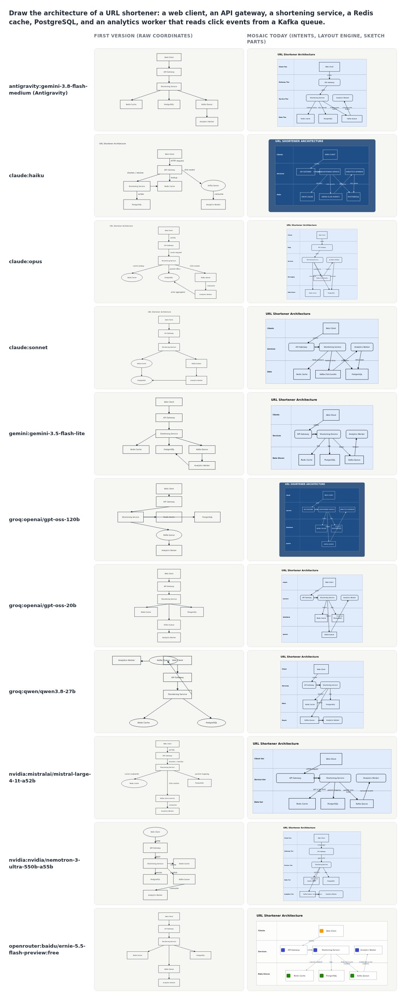
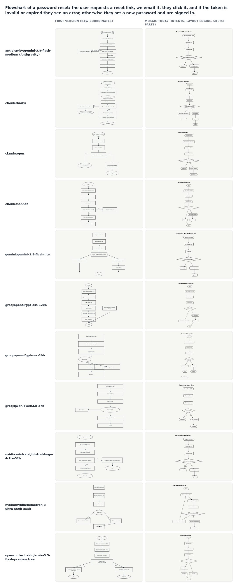
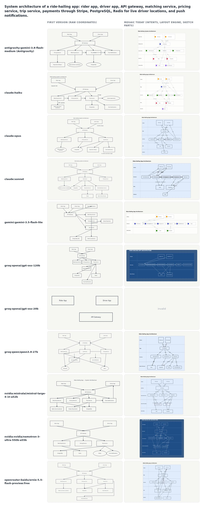
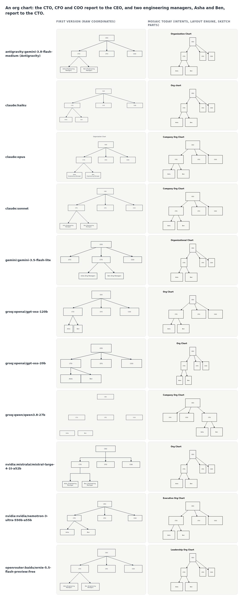
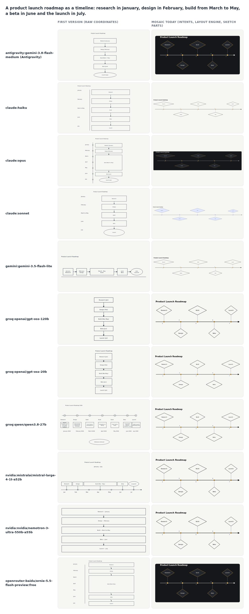
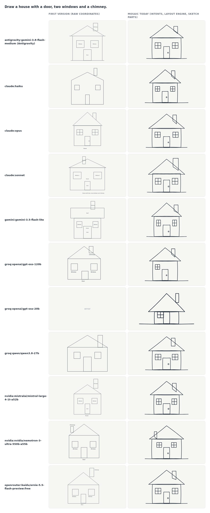
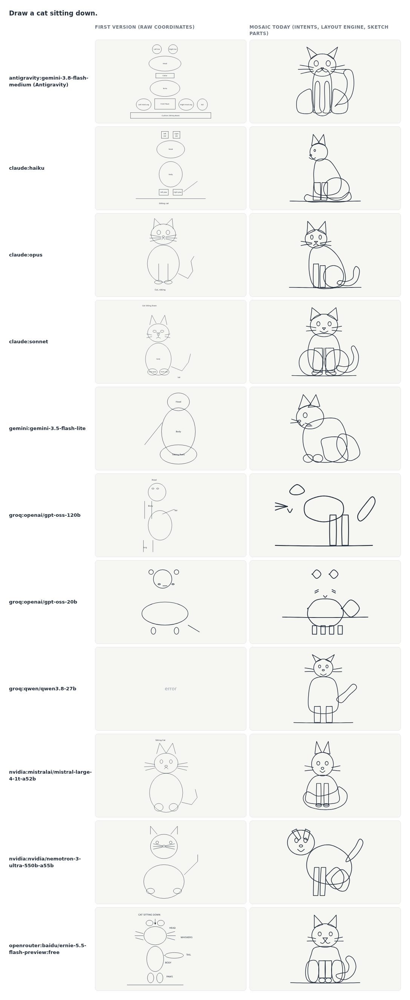
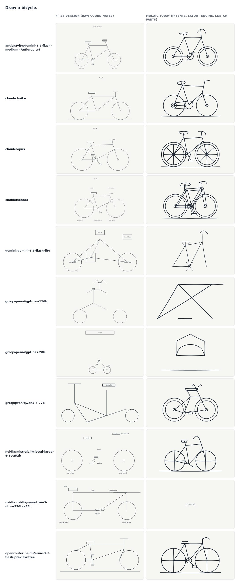
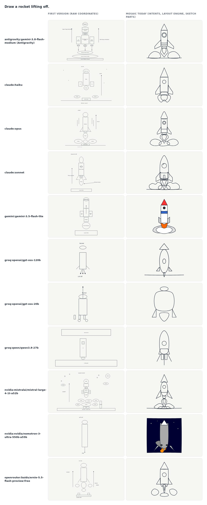
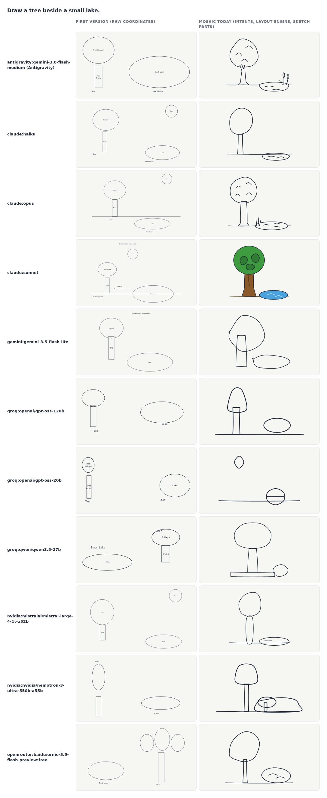

# Assistant model benchmark: every drawing

Each image is one task. Every model drew it twice: through the assistant's first version (raw coordinates on a
fixed grid) and through Mosaic today (typed intents, the diagram style engine and named sketch parts). The numbers
behind these are in [model-benchmark.md](model-benchmark.md), and `node benchmark/renderModelGallery.js` redraws them
from the saved results. These images draw each connector straight between its ends; on a board, a routed link
bends around the cards in its way.

## Draw the architecture of a URL shortener: a web client, an API gateway, a shortening service, a Redis cache, PostgreSQL, and an analytics worker that reads click events from a Kafka queue.

## Flowchart of a password reset: the user requests a reset link, we email it, they click it, and if the token is invalid or expired they see an error, otherwise they set a new password and are signed in.

## System architecture of a ride-hailing app: rider app, driver app, API gateway, matching service, pricing service, trip service, payments through Stripe, PostgreSQL, Redis for live driver locations, and push notifications.

## An org chart: the CTO, CFO and COO report to the CEO, and two engineering managers, Asha and Ben, report to the CTO.

## A product launch roadmap as a timeline: research in January, design in February, build from March to May, a beta in June and the launch in July.

## Draw a house with a door, two windows and a chimney.

## Draw a cat sitting down.

## Draw a bicycle.

## Draw a rocket lifting off.

## Draw a tree beside a small lake.

