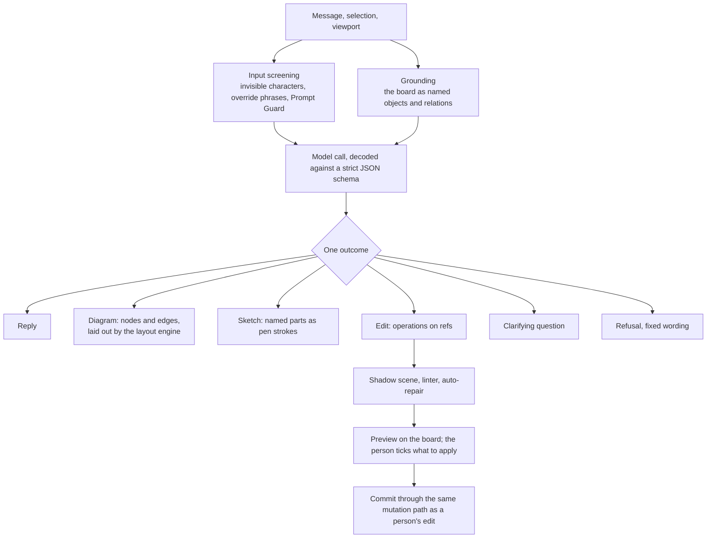
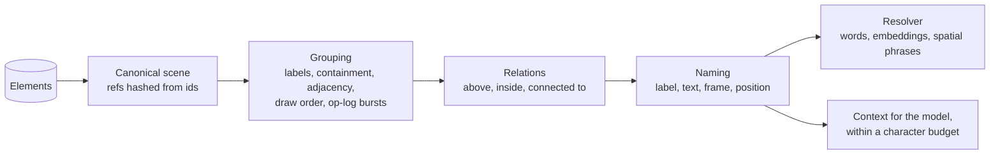

# The AI assistant

One message box handles questions, new diagrams, freehand sketches and edits to what is already on the board.
Each message is one **turn**: the backend works out what was meant, asks the model for exactly one outcome, and
checks that outcome with deterministic code before anything reaches the board.

## One turn

The model never places anything. Diagrams come back as nodes and edges and the layout engine in `shared/`
computes every position; edits name objects by ref and relations by name, never by coordinate.

## Grounding

Editing needs the model to know what is already there. `backend/src/grounding/` turns raw elements into objects
a person would point at:

- **Refs are stable.** A ref is a hash of the element id, so it survives rebuilds; a group keeps its ref while
  most of its members stay.
- **Ambiguity asks.** The resolver returns resolved, ambiguous with a shortlist, or none, rather than always
  guessing.
- **Large boards scope to the viewport.** Relations are quadratic in object count, so past 1,500 elements a
  caller that sends its viewport is grounded only around what it can see; whole-board scenes are cached by the
  room's operation sequence.
- **One implementation.** The assistant and the MCP server's `describe_board` and `resolve` tools call the same
  grounding endpoints.

## Edits are reviewed

An edit runs against a copy of the board first. The linter flags new overlaps, frame escapes, dangling
connectors, text overflow, low contrast and broken alignment, counting only what this edit introduced.
`repair.js` fixes what has one right answer and sends the rest back to the model once. The person then sees the
change drawn on the board, can untick any part, and hold to compare. What is applied is exactly what was
reviewed, re-checked per element against the live board and the person's role. Any applied edit can be undone
from the chat later, leaving alone whatever has changed since.

## What an edit can do

The edit language in `backend/src/ai/edits/editLanguage.js` is the only way the assistant changes a board:
arrange (align, distribute, place, move, tidy, resize, rotate, reorder), connect and disconnect, restyle (colour,
fill, opacity, stroke and font), set the words on anything that holds them, group, frame, lock, duplicate, delete,
clean up hand-drawn shapes, and add notes, text in a chosen colour and size, labelled shapes, tables and icons.
Later operations in one batch name what earlier ones created as `new1`, `new2` and so on, so "add a box and
connect it to Login" or "put three notes in a frame" is one reviewed batch. Unticking an operation in review keeps
that numbering, so anything that depended on it fails the commit instead of landing on the wrong object.

## Safety

The working assumption is that prompt injection can't be fully prevented, so a successful one must have nothing
useful to do. Each layer holds if the one before it fails.

| Layer             | What it does                                                                                                                                                                                      |
| ----------------- | ------------------------------------------------------------------------------------------------------------------------------------------------------------------------------------------------- |
| Input screening   | Strips invisible characters, matches override phrases on a normalised copy, and runs Llama Prompt Guard. A flagged turn is restricted, not blocked: it can only propose a reviewed change.        |
| Untrusted content | Board text sits between random per-turn markers outside the system role. Text that reads like instructions is hidden and turns off auto-apply. Refused exchanges never re-enter the conversation. |
| Strict output     | The model is decoded against a strict schema, so free prose can't come back, and every outcome is validated in code.                                                                              |
| Output checks     | Replies are checked for code, credentials and a per-turn canary that reveals a system-prompt leak. Links and images are removed.                                                                  |
| Least privilege   | The validated edit language is the only way to change a board, re-checked against live refs and the caller's role at commit.                                                                      |
| Human approval    | Changes are previewed by default. Auto-apply covers only low-risk plans: nothing destructive, sweeping, lint-flagged or shaped by suspicious text.                                                |
| Failure handling  | Typed provider errors with fixed messages, retries that honour `retry-after`, fallback models, a circuit breaker, per-turn deadlines and call ceilings.                                           |
| Observability     | Each turn records an OpenTelemetry GenAI-style trace (model, tokens, spans, guard results) with no prompt or output text.                                                                         |

## Models

All roles share `GROQ_API_KEY` and an OpenAI-compatible API, so changing provider is a URL and model change.

| Role         | Default                                     | Job                                                        |
| ------------ | ------------------------------------------- | ---------------------------------------------------------- |
| Reasoning    | `qwen/qwen3.8-27b`                          | The turn itself                                            |
| Fallback     | `openai/gpt-oss-20b`, `openai/gpt-oss-120b` | Tried in order when the reasoning model is limited or down |
| Prompt guard | `meta-llama/llama-prompt-guard-2-86m`       | Screens each message; its outage never stops a turn        |
| Stylist      | `openai/gpt-oss-20b`                        | Picks a diagram's structure and look                       |

Each role's model can be overridden with `AI_MODEL_REASONING`, `AI_MODEL_FALLBACK`, `AI_MODEL_PROMPT_GUARD` and
`AI_MODEL_STYLIST`. A slower provider may need a longer `AI_CALL_TIMEOUT_MS` (one call, 20 seconds by default) or
`AI_TURN_DEADLINE_MS` (a whole turn, 45 seconds). How different models fare on the same tasks, through the first
version of the assistant and through today's: [`benchmark/README.md`](../benchmark/README.md#assistant-model-benchmark).

## Measuring it

- `npm run eval:ai` (in `backend/`) runs the real prompt against the real model on normal requests and attacks,
  and fails on a regression.
- `npm run eval:conversations` plays whole multi-turn conversations and writes each final board as an SVG.
- [`benchmark/`](../benchmark/README.md) grades 54 edit instructions structurally: 78.3% top-1 resolution,
  97.8% top-3, every refusal correct.

Both evals spend API quota, so neither is part of `npm test`.
