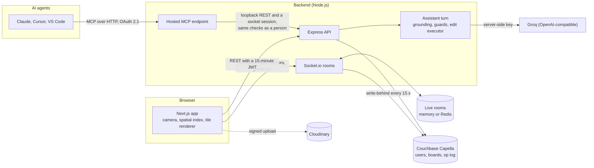
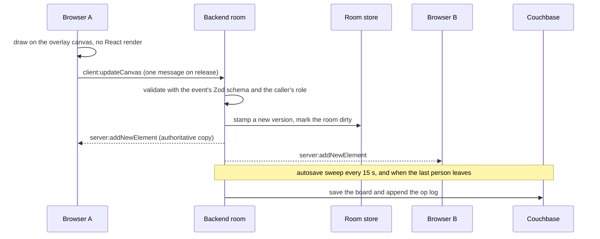
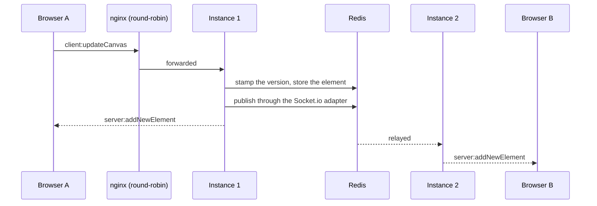

# Architecture

Mosaic is three deployable parts and one shared library: a Next.js frontend, an Express and Socket.io backend,
an MCP server that lets AI agents work on boards, and `shared/`, the board model all three import.

## System



| Part         | Folder        | Runs on                                   | Holds                                                        |
| ------------ | ------------- | ----------------------------------------- | ------------------------------------------------------------ |
| Frontend     | `frontend/`   | Vercel or any Node host                   | Pages, the board engine, the design system                   |
| Backend      | `backend/`    | Render or any container host              | REST API, live rooms, auth, the assistant, hosted MCP        |
| MCP server   | `mcp-server/` | Inside the backend, or locally over stdio | Board tools for AI agents                                    |
| Shared model | `shared/`     | Imported by all three                     | Geometry, elements, strokes, history, layout, diagram styles |

## A stroke, end to end



## State lives in three places

| Layer             | Holds                                                                                                                | Lifetime                        |
| ----------------- | -------------------------------------------------------------------------------------------------------------------- | ------------------------------- |
| Browser           | Elements in React state; camera and spatial index outside React; Redux for tools and UI; a per-tab undo stack of 100 | The tab                         |
| Live room         | Elements, versions, presence and the dirty set, in memory or in Redis when `REDIS_URL` is set                        | While anyone has the board open |
| Couchbase Capella | Users, boards, the append-only operation log, snapshots, comments, conversations                                     | Permanent                       |

Version history, the replay scrubber and branch diffs are three readings of the one operation log, which is why
forking from any point in the past is cheap.

## Rendering

The board paints on two canvases. Committed elements go to a static layer built from cached 512 x 512 bitmap
tiles, so panning composites finished images; in-progress strokes and drags go to an overlay that never touches
React. A spatial index answers what is on screen, so a repaint costs what is visible, not what is on the board.
On integrated graphics, panning holds 3.3 to 3.5 ms a frame from 10,000 to 50,000 elements. Method and full
results: [`frontend/perf/README.md`](../frontend/perf/README.md).

## Scaling out

Without `REDIS_URL` the backend runs as one process with rooms in memory. With it, every part of a room lives in
Redis, Socket.io broadcasts cross instances through the Redis adapter, and rate limits are shared, so a load
balancer can round-robin connections with no sticky sessions.



Losing an instance mid-session loses nothing: the dirty set is shared too, so the survivor's next autosave
persists the lost instance's last writes. Run it locally with
`docker compose -f docker-compose.scale.yml up --build --scale backend=2`.

## Security boundaries

- **Every mutation is re-authorised.** The same role check (owner, editor, commenter, viewer) runs in the REST
  middleware and in every mutating socket handler; hiding a tool in the UI is only a convenience.
- **Every payload is validated.** Each REST body and socket event has its own Zod schema covering ids, element
  shapes, point counts and sizes, so a malformed frame is dropped before it can desync a room.
- **Identity comes from the token, never the body.** Handlers act on `req.user.userId` from a verified JWT.
- **Sessions are short and revocable.** Access tokens last 15 minutes; refresh tokens rotate, are stored only as
  hashes, and reuse of an old one ends the sign-in. Changing a password ends every other sign-in.
- **The browser's address is vouched for.** Sign-in and token renewal reach the backend from the Next.js server,
  which sends the browser's address with a shared key; rate limits trust it only with that key.
- **Secrets stay server-side.** The model key, upload signing and social sign-in completion never reach the
  browser.

## Repository layout

```
backend/src/       http/ (routes, controllers, middlewares), realtime/, ai/ (model, turn, edits, safety, eval),
                   grounding/, liveRooms/, models/, db/, auth/, validation/, services/, observability/
frontend/src/      pages/, features/<product area>/, components/ (shared UI, vendor/), store/, lib/, hooks/
shared/canvas/     geometry/, elements/, strokes/, editing/, history/, color/, pieces/, mermaid/, diagramStyles/
mcp-server/src/    tools, board session, backend client, hosted transport
benchmark/         the canvas edit benchmark and the grounding ablation
```
